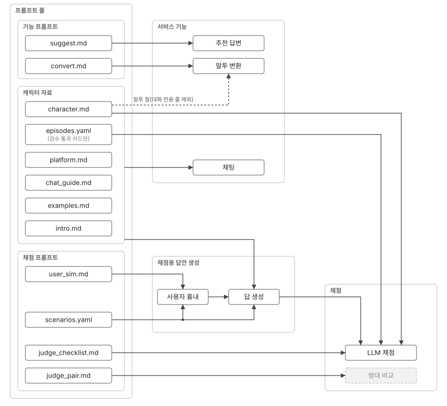

# 프롬프트 지도

- 기능·평가마다 어떤 프롬프트 파일이 들어가는지 정리
- 프롬프트 파일을 추가·삭제하거나 읽는 코드를 바꾸면 같이 고침
- 점검: 아래 "점검 명령" 결과와 표가 맞는지 확인

## 한눈에

- 프롬프트로 들어가는 것만. 코드 검사(규칙 검사 등)는 뺌
- 그림 원본: `docs/prompt-map.svg`(직접 작성한 SVG. 박스·선 좌표를 고쳐서 갱신)



- 흐름: 프롬프트 풀 → 서비스 기능 / 프롬프트 풀 → 채점용 답안 생성 → 채점
- 서비스 기능과 채점용 답안 생성에 같이 이어진 것 = 공유 프롬프트(캐릭터 자료 칸 전체 → 채팅·답 생성)
- 칸(캐릭터 자료)에 닿는 선 = 칸 안 전부. 점선: 선 위 글자 부분만 들어감
- 회색: 호출하는 곳 없음
- scenarios.yaml의 `note`는 LLM 채점·쌍대 비교에도 들어감(선 생략)
- 추천 답변·말투 변환은 채점 기능이 없음
- 첫 인사(intro.md 그대로 표시)와 채점자 일치율(LLM 채점과 같은 프롬프트)은 그림에서 뺌 → 아래 표 참고

## 기능별

| 기능 | 코드 | 모델 | 들어가는 프롬프트(순서대로) | 자리표시 |
|---|---|---|---|---|
| 채팅 | `app/prompt.py` `build_messages` | `CHAT_MODEL`(Sonnet) | system: platform → character → chat_guide → examples → "이미 첫 인사를 했다" + intro → 검수 카드. 그 뒤 대화 | 없음(파일을 이어 붙임) |
| 첫 인사 | `app/main.py` `/api/intro` | 없음 | intro.md를 그대로 화면에 | 없음 |
| 추천 답변 | `app/main.py` `/api/suggest` | `SUGGEST_MODEL`(Haiku) | suggest.md 하나(user 메시지) | `{conversation}` |
| 말투 변환 | `app/main.py` `/api/convert` | `CHAT_MODEL` + 추론 | convert.md 하나(user 메시지) | `{speech_rules}`: character.md "## 말투" 절에서 대화 전용 줄(`CHAT_ONLY`) 뺀 것. `{text}`: 사용자 입력 |

- 캐릭터 자료 = 채팅의 전부. character.md는 변환기·채점자에도 들어감 → 고치면 세 곳이 같이 바뀜
- 추천 답변은 캐릭터 자료를 안 씀(대화만 봄)

## 평가별

| 평가 | 코드 | 모델 | 들어가는 프롬프트 | 자리표시 |
|---|---|---|---|---|
| 답 생성 | `eval/run.py` `_reply` | 실행 시 `--model` | 채팅과 같음(`build_messages`) | - |
| 사용자 흉내(긴 대화) | `eval/run.py` | Haiku | user_sim.md | `{note}`, `{conversation}` |
| LLM 채점 | `eval/judge.py` `checklist` | `JUDGE_MODEL`(luna) | judge_checklist.md. `===` 위는 system(캐시), 아래는 user | `{reference}`: character.md + 검수 카드. `{category}`, `{note}`, `{conversation}`, `{response}`, `{items}` |
| 쌍대 비교 | `eval/judge.py` `pair` | `JUDGE_MODEL` | judge_pair.md. 순서 바꿔 2번 | `{note}`, `{conversation}`, `{a}`, `{b}` |
| 채점자 일치율 | `eval/agree.py` | `--model` | LLM 채점과 같음(judge_checklist.md) + 골든셋 응답 | - |
| 말투 변환 평가 | 스크립트 없음 | - | convert.md + `eval/convert_scenarios.yaml`(그때그때 실행) | - |
| 추천 답변 평가 | 없음 | - | - | - |

- 시나리오의 `note`는 사용자 흉내·채점·쌍대 비교 세 곳에 들어감 → `note`를 고치면 평가 결과도 바뀜
- 채점 기준(`{reference}`)이 character.md를 통째로 품음 → 캐릭터를 고치면 채점 자도 같이 바뀜

## 프롬프트 파일 목록

| 파일 | 쓰는 곳 |
|---|---|
| `character/platform.md` | 채팅 |
| `character/character.md` | 채팅, 말투 변환(말투 절), LLM 채점(참고 자료) |
| `character/chat_guide.md` | 채팅 |
| `character/examples.md` | 채팅 |
| `character/intro.md` | 채팅, 첫 인사 |
| `character/episodes.yaml` | 채팅, LLM 채점(검수 통과분만) |
| `character/research.md` | 안 씀(작성용 자료) |
| `app/prompts/suggest.md` | 추천 답변 |
| `app/prompts/convert.md` | 말투 변환 |
| `eval/prompts/judge_checklist.md` | LLM 채점, 채점자 일치율 |
| `eval/prompts/judge_pair.md` | 쌍대 비교(현재 호출하는 곳 없음) |
| `eval/prompts/user_sim.md` | 사용자 흉내 |

## 점검 명령

```bash
ls character app/prompts eval/prompts                      # 파일 목록이 위 표와 같은지
grep -rnE '_read\(dir|\.md"|\.yaml"|"(judge_checklist|judge_pair|user_sim)"' app eval --include='*.py'  # 읽는 곳이 위 표와 같은지
```
